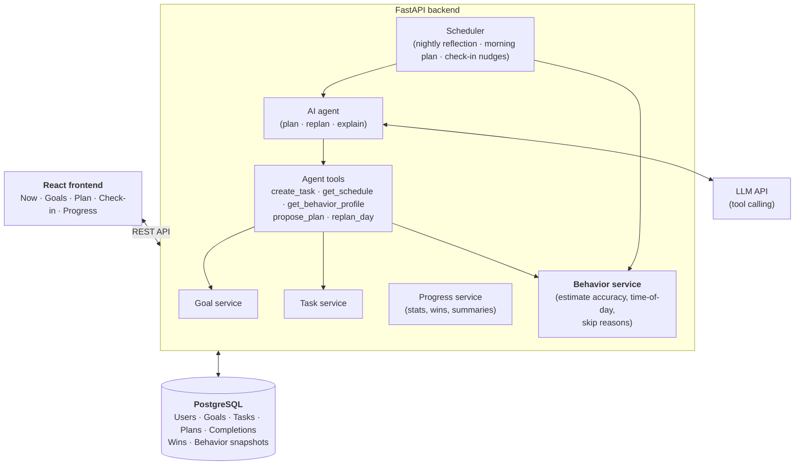

# Momentum

> **An AI personal execution agent that turns your goals into realistic daily actions, helps you follow through, and adapts when life doesn't go according to plan.**

People don't need another tool to *create* plans. They need a system that helps them *follow through* on those plans and adapts when they don't.

**Momentum is an execution system, not a planning tool.**

---

## Table of contents

1. [The problem](#the-problem)
2. [What Momentum is](#what-momentum-is)
3. [Who it's for](#who-its-for)
4. [What makes it different](#what-makes-it-different)
5. [How it works](#how-it-works)
6. [Core use cases](#core-use-cases)
7. [Architecture](#architecture)
8. [Data model](#data-model)
9. [Using the LLM sensibly](#using-the-llm-sensibly)
10. [Tech stack](#tech-stack)
11. [Roadmap](#roadmap)
12. [Risks and how we handle them](#risks-and-how-we-handle-them)
13. [How we measure success](#how-we-measure-success)
14. [FAQ](#faq)

---

## The problem

People usually know what they need to do. Their problem is **follow-through**.

A familiar cycle:

1. Write a to-do list in the morning.
2. Don't finish some of it.
3. Move the same tasks to tomorrow.
4. Repeat until the list is overwhelming, then abandon it.

Most productivity apps can *remind* you that something is unfinished. They don't help you **recover from failure and get moving again**, and they never question whether the plan itself was realistic.

Momentum removes the constant mental decisions:

- *What should I do now?*
- *When should I do it?*
- *How long should I spend on it?*
- *What did I actually accomplish?*

It turns them into one instruction: **"This is what you should do now."**

---

## What Momentum is

Momentum manages the **execution** of your goals rather than maintaining a to-do list.

You tell it something like:

> "I want to improve SQL, exercise regularly, finish my project, and learn system design."

It decides what to work on, when, for how long, and with what resources. It tracks completed tasks, unfinished tasks, habits and small wins, and keeps adjusting the plan **based on what you actually did, not what you said you would do.**

---

## Who it's for

**Primary users:** students and early-career professionals who already make plans but struggle with consistency.

They are typically juggling:

- Learning new technical skills
- Work and personal projects
- Fitness and health goals
- Personal responsibilities
- Long-term goals that keep getting postponed

**Business model:** B2C first. The same engine could later serve B2B (employee development, training programs, goal tracking), but that is out of scope for the first versions.

---

## What makes it different

### The one-line answer

> **Other tools reschedule your tasks. Momentum corrects your plan.**

Rescheduling a missed task is a solved problem. Momentum's difference is that it **learns from the gap between what you planned and what you actually did**, and changes *how* it plans, not just *when*.

### Compared with AI schedulers (Motion, Reclaim, Sunsama, and others)

AI schedulers are built around **your calendar and deadlines**. You give them tasks and estimates; they fit those tasks into free time and push them forward when something slips. They treat **your estimate as the truth**.

Momentum treats **your estimate as a hypothesis** and corrects it with evidence.

| | AI calendar schedulers | Momentum |
| --- | --- | --- |
| Core job | Fit tasks into your calendar | Get you to actually follow through |
| Your time estimates | Taken as given | Corrected from your history ("you usually take 1.6× longer on coding tasks") |
| When you miss a task | Moves it to the next free slot | Asks why, then changes the plan (smaller block, better time, fewer tasks) |
| What it learns | Your calendar and priorities | Your real behavior: when you work, how long things take, why you skip |
| Best fit | Work tasks with hard deadlines | Self-driven goals with no one forcing you (learning, fitness, side projects) |
| Measures | Tasks scheduled and done | Whether your plans are becoming *realistic* and whether you're improving |

### What to say when someone asks "How is this different from Motion?"

> "Motion is great at fitting tasks into your calendar. When you miss something, it moves it. Momentum asks a different question: *why* did you miss it, and is the plan itself wrong? If you planned two hours of study every evening but you've only managed 30 minutes for three days, Motion will keep rescheduling two-hour blocks. Momentum notices the pattern and plans 45 minutes instead, at the time of day you actually follow through. It's built for self-driven goals like learning and fitness, where there's no deadline or boss, and the only thing standing between you and progress is follow-through."

### Compared with a general AI assistant (Claude, ChatGPT)

A general assistant can write an excellent 30-day plan. But:

- It only knows what you **tell** it, not what you **did**.
- It responds when you ask; it doesn't run a feedback loop.
- It has no structured record of planned vs. actual time, skip reasons or completion patterns.

### Compared with Notion or Todoist

These hold your tasks well, but they are passive. They don't decide what you do next, and they don't adapt when the plan isn't working.

### A concrete example

A user wants to learn system design while working full-time. They plan two hours every evening.

| Day | Planned | Actual | Reason given |
| --- | --- | --- | --- |
| Mon | 120 min | 30 min | Too tired |
| Tue | 120 min | 25 min | Too tired |
| Wed | 120 min | 35 min | Ran out of time |

- **A task manager:** shows 3 overdue tasks and a growing backlog.
- **An AI scheduler:** keeps finding new two-hour slots.
- **A general assistant:** suggests a new schedule, if the user remembers to ask.
- **Momentum:** sees that evening sessions finish at about 25% of plan and that the reason is fatigue. It proposes 40-minute sessions, moves one session per week to Saturday morning, and stretches the timeline so the goal is still reachable. It tells the user *why* it made the change.

**The system doesn't just remember what the user said. It learns from the difference between what the user planned and what the user actually did.** That is the product hypothesis Momentum is built to test.

---

## How it works

### The core loop

```
Goal → Plan → Execute → Observe → Reflect → Replan
                 ↑                              │
                 └──────────────────────────────┘
```

1. **Goal:** the user states a goal in plain language.
2. **Plan:** the agent breaks it into tasks with time estimates, **adjusted by the user's behavior profile**.
3. **Execute:** the user sees one thing: *"Do this now: SQL JOIN practice, 40 minutes."*
4. **Observe:** the user marks it done, partly done or skipped, with a one-tap reason and the actual time spent.
5. **Reflect:** a nightly job updates the behavior profile (plain statistics, no LLM).
6. **Replan:** tomorrow's plan uses the updated profile.

### What Momentum learns (the behavior model)

These are computed from execution history with plain statistics:

| Signal | Example |
| --- | --- |
| **Estimate accuracy per category** | "Coding tasks take you 1.6× your estimate." |
| **Completion rate by time of day** | "You finish 80% of morning tasks and 30% after 9 pm." |
| **Completion rate by day of week** | "Fridays are a low-energy day." |
| **Session length** | "Sessions over 60 minutes are usually cut short." |
| **Skip reasons** | "Most skips this week were 'too tired'." |
| **Streaks and consistency** | "Exercise on 4 of the last 7 days." |

The LLM receives a **short summary** of this profile when it plans. It never gets the raw history.

### Recovering from failure

When a task is missed, Momentum doesn't just roll it over. It:

1. Asks what happened (one tap: *too tired · ran out of time · forgot · not important anymore · did part of it*).
2. Decides what to do: shrink it, move it, split it, or drop it.
3. Explains the change: *"Shortened to 30 min since evening sessions have been running short this week."*

---

## Core use cases

### 1. Daily execution

The user says: *"I need to improve SQL, finish my project and exercise four times this week."*

Momentum breaks those goals into realistic tasks and schedules them around the user's available time. When the user opens the app, they don't see 15 things to choose from. They see:

> **Do this now: SQL JOIN practice, 40 minutes.**

If they complete it, Momentum records the win. If they don't, it asks what happened and replans.

### 2. Wins and progress

Momentum records **wins**, not just failures: a finished study session, a workout, a protein goal, a step goal, an important work task.

Daily, weekly and monthly summaries show:

- Consistency and streaks
- Completed goals and habits
- Missed commitments
- **Plan accuracy**: how close your plans are getting to reality
- Improvement compared with previous periods

The message is **"you are actually getting better"**, not "here's everything you haven't done."

### 3. Learning companion (V2)

If today's task is *"Learn database indexing,"* Momentum turns a vague hour into a structured session:

> Read this concept → understand this example → solve these three questions → answer an interview question.

It can find resources, explain concepts, generate practice questions, and check whether the user actually understood the material.

### 4. Rewards (V2)

Users choose their own rewards (a movie, a favorite meal, a café visit, gaming time). Rewards unlock on **real progress**, such as a consistency streak or a finished milestone, not on arbitrary points.

### 5. Focus protection (V3)

During a committed focus session, Momentum can block distracting apps and sites.

---

## Architecture



### Components

| Component | Responsibility | Uses LLM? |
| --- | --- | --- |
| **Goal service** | Create and update goals, target dates, priority | No |
| **Task service** | Tasks, plans, completions, skip reasons | No |
| **Progress service** | Wins, streaks, daily/weekly/monthly summaries | No (optional LLM for a friendly summary) |
| **Behavior service** | Computes the behavior profile from execution history | **No.** Plain statistics, which keeps it cheap and testable |
| **AI agent** | Breaks goals into tasks, plans days, replans, explains changes | Yes |
| **Agent tools** | Typed Python functions the agent can call | n/a |
| **Scheduler** | Nightly reflection job, morning plan, check-in reminders | No (APScheduler in V1; Temporal later if needed) |

### Design principles

- **The agent proposes; the user decides.** The agent writes a *proposed* plan. The user accepts or edits it, and those edits become learning data too.
- **The app owns the state; the LLM provides the reasoning.** PostgreSQL is the source of truth. The LLM never "remembers" anything on its own.
- **Deterministic where possible.** Stats, streaks, completions and the behavior profile are plain code with unit tests.
- **Every plan change comes with a reason.** Users should always know *why* the plan changed.

---

## Data model

Core tables for V1:

| Table | Key fields |
| --- | --- |
| `users` | id, name, timezone, available_hours (per weekday), preferences |
| `goals` | id, user_id, title, category, target_date, priority, status |
| `tasks` | id, goal_id, title, category, **estimated_minutes**, status |
| `plans` | id, user_id, date, status (`proposed` / `accepted`), rationale |
| `plan_items` | id, plan_id, task_id, scheduled_start, **planned_minutes**, order |
| `completions` | id, plan_item_id, **outcome** (`done` / `partial` / `skipped`), **actual_minutes**, **skip_reason**, completed_at |
| `wins` | id, user_id, type, description, date |
| `behavior_snapshots` | id, user_id, date, estimate_ratio_by_category, completion_rate_by_hour, completion_rate_by_weekday, top_skip_reasons |

The **bold** fields are the core of the product. Without planned vs. actual time and outcome reasons, there is nothing to learn from.

---

## Using the LLM sensibly

We don't send the user's whole history to the LLM on every call. That wastes tokens and money.

| Operation | How it's handled |
| --- | --- |
| Mark a task complete | Plain API call, no LLM |
| Weekly stats, streaks | SQL and Python, no LLM |
| Behavior profile | Python statistics, no LLM |
| Break a goal into tasks | LLM (stronger model) |
| Plan or replan a day | LLM with a **compact context**: today's tasks, open goals, behavior summary |
| Explain a plan change | LLM (cheaper model) |
| Learning explanations and questions (V2) | LLM |

**Model routing:** a cheaper, faster model for simple generation, and a stronger model only when deeper reasoning is needed.

---

## Tech stack

| Component | Technology |
| --- | --- |
| Frontend | React + TypeScript + TailwindCSS (Vite) |
| UI components | shadcn/ui, lucide icons, Recharts, Framer Motion |
| Frontend data | TanStack Query (optimistic updates) |
| Backend | Python + FastAPI |
| Database | PostgreSQL |
| ORM | SQLAlchemy |
| Migrations | Alembic |
| Validation | Pydantic |
| Background jobs | APScheduler (V1) → Temporal (only if long-running workflows need it) |
| AI | LLM API with tool calling |
| Testing | Pytest |
| Deployment | Docker + Docker Compose |

We are deliberately **not** adding Redis, Kafka, Neo4j or Kubernetes until there is a real need.

---

## Roadmap

### V1: prove the core loop

The goal of V1 is to test one hypothesis: **does learning from planned vs. actual make plans more realistic and improve follow-through?**

- Goals → AI breaks them into tasks with estimates
- Daily plan (proposed by the agent, accepted or edited by the user)
- **"Do this now"** screen
- One-tap check-in: done / partial / skipped + reason + actual time
- Nightly behavior profile update
- Replanning that uses the behavior profile, with an explanation for each change
- Wins and a weekly progress summary (including plan accuracy)
- End-of-day check-in reminder

### V2: make it smarter and more helpful

- Learning companion: resources, explanations, practice questions, comprehension checks
- User-chosen rewards tied to real progress
- Google Calendar integration (read busy times, write focus blocks)
- Deeper pattern analysis and insights
- Voice check-ins

### V3: proactive intervention

- App and website blocking during focus sessions
- Proactive nudges ("You usually skip after 9 pm; want to start now?")
- Mobile app

| Version | Target |
| --- | --- |
| V1 released | Jan 11, 2027 |
| V1.1 with test users | Jan 25, 2027 |
| V2 | Mar 21, 2027 |
| V3 | Optional, only if V1/V2 prove the idea |

- [PLAN.md](PLAN.md): what each phase builds, plus the UI/UX standards
- [SCHEDULE.md](SCHEDULE.md): the day-by-day schedule

---

## Risks and how we handle them

| Risk | Why it matters | Mitigation |
| --- | --- | --- |
| **The users who need it most stop opening the app** | People who struggle with follow-through also stop logging | End-of-day reminder; one-tap check-in; no guilt-heavy UI; a "fresh start" option after a bad week |
| **Cold start** | The adaptive loop needs 1–2 weeks of data | Sensible defaults (e.g. pad estimates by 1.3×), quick onboarding questions about energy and available time, and a seeded demo account |
| **Noisy self-reported data** | People forget or misreport | Keep input minimal, accept "partial", and use trends rather than single data points |
| **LLM plans that are unrealistic or wrong** | Erodes trust fast | Agent proposes, user approves; hard limits from available hours; validated tool inputs |
| **Too many features too early** | The core hypothesis never gets tested | V1 scope is fixed; rewards, learning and blocking wait for V2+ |
| **"It's just Claude with a database"** | A common objection | The behavior model, the structured feedback loop and plan-accuracy metrics are things a chat assistant doesn't do |

---

## How we measure success

**Primary metric: plan completion rate**

```
plan completion rate = actual minutes completed / planned minutes
```

**The hypothesis holds if:** plan completion rate rises from week 1 to week 3 *because plans became more realistic*, while total productive time stays the same or grows.

Secondary metrics:

- **Estimate accuracy:** how close planned minutes are to actual minutes, over time
- **Check-in rate:** % of days the user logs outcomes (shows whether they're still engaged)
- **Recovery rate:** after a missed day, how often the user is back on track within 2 days
- **Goal progress:** milestones reached per goal

**Validation plan:** the builder uses Momentum daily for three weeks before anyone else does, then runs it with 5–10 students or early-career professionals for two weeks.

---

## FAQ

**Isn't this just Claude with a database?**

That's a fair question. Claude can help someone create a plan, and we're not claiming planning itself is unique.

The difference is the **execution system around the AI**: structured goals and tasks, persistent execution history, a behavior model computed from that history, progress tracking, and adaptive replanning in one workflow.

The LLM provides the reasoning. The application manages the state, the workflow and the feedback loop. Our hypothesis is that a system grounded in a user's *actual* execution history gives more useful next actions than a general assistant that only responds to individual requests.

**Isn't this just Motion?**

See [What makes it different](#what-makes-it-different). In short: Motion fits your tasks into your calendar and moves them when you miss them. Momentum learns *why* you miss them and changes the plan itself. It's built for self-driven goals, not deadline-driven work.

**Why not just use reminders?**

Reminders tell you something is unfinished. They don't tell you whether the plan was realistic, and they don't help you recover.
